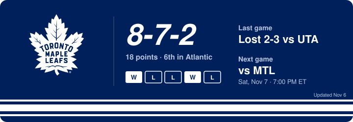

<h2 align='center'> Hi, I'm Bhavya </h2> 

  Focus in robotics, developer tooling and scalable systems.  
  AI is great at writing code until I'm the one finding out why prod is down at 3 a.m.

  
  
  

---

### About me

- Recent CS/BBA new grad from Uwaterloo. Seeking **new grad software engineering roles**
- Most recently at **Figure AI**, building test and observability tooling for humanoid robots. Previously at theScore, Dayforce, Cmic x2
- Outside of code, I'm learning to snowboard 🏂 and I'm a Toronto Maple Leafs fan 🍁, so I'm used to falling in the winter and collapsing in the spring.

- Built this leafs score card that updates every morning to remind me of the saying "This is our year" - Go leafs Go

  

